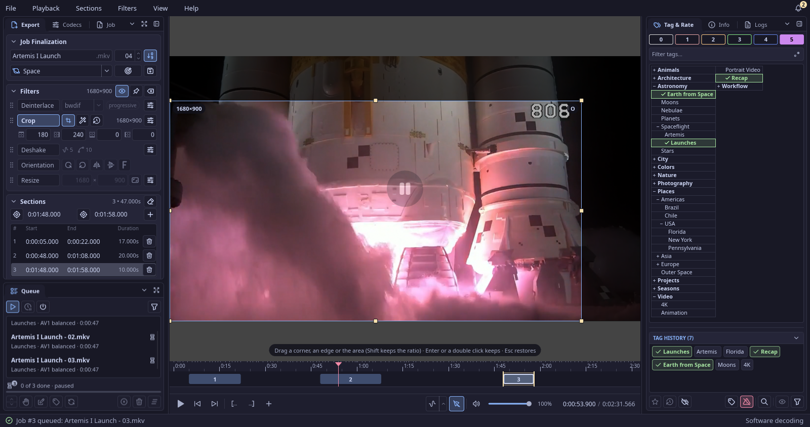
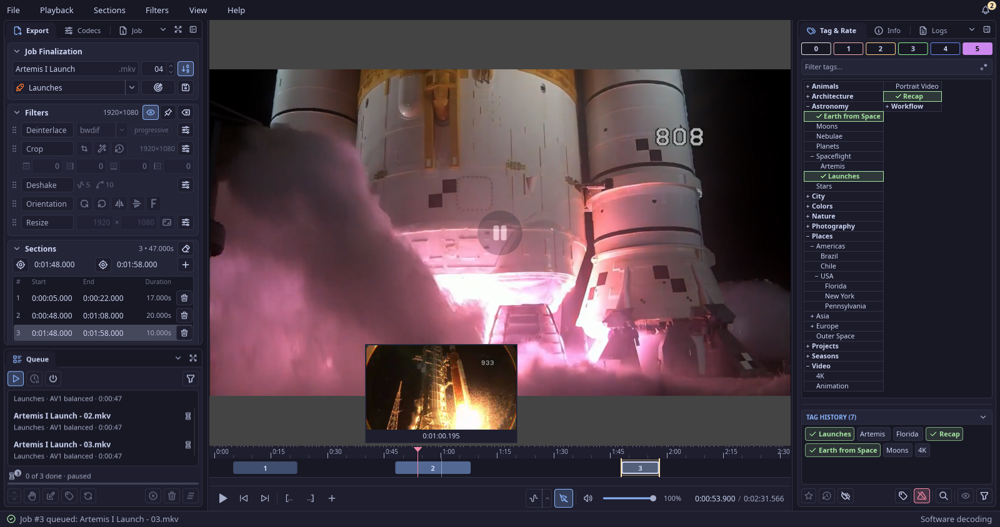
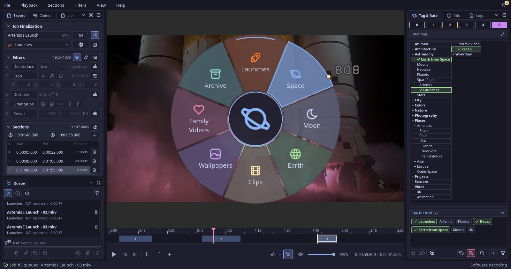
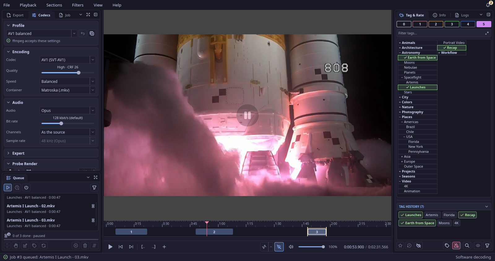

# RustCut

[](LICENSE)
[](https://github.com/vommie/rustcut/releases)


A fast local video cutter for Arch Linux / KDE Plasma, written in Rust with a Slint UI and mpv as the player: mark sections,
apply filters, render them through a queue with professional encoding profiles, and tag and rate the clips directly in the
[RustView](https://github.com/vommie/rustview) library.

RustCut is the successor of [PyCutXN](https://github.com/vommie/pycutxn). Status: early releases (0.0.x) on the
[Releases page](https://github.com/vommie/rustcut/releases); [CHANGELOG.md](CHANGELOG.md) lists what changed.


## Features

- **Sections on a timeline:** mark start and end with keys or the mouse, move, resize, duplicate and reorder sections, frame-exact
  seeking, J/K/L shuttle, thumbnails over the timeline while you hover it.
- **Filters with a live preview:** crop (drawn on the video, auto-crop, crop history), deinterlace, resize, orientation (rotate, mirror)
  and deshake; preview and render use the same filter chain.
- **Render queue:** several jobs at once (never two to the same target), pause and reorder; every output is written to a temporary
  file, checked with ffprobe and only then renamed into place.
- **Encoding profiles** for x264, x265, SVT-AV1 and rav1e with a simple view (quality, speed) and an expert view; ffmpeg checks a profile
  before you use it, and a probe render plays a few seconds of the result.
- **Tag & Rate in RustView:** RustView's tag tree (also in its compact mode), history and rating bar; the rendered clips appear in
  RustView with their tags and rating.
- **Target folders and the folder wheel:** favorite folders with icons, colors and their own place on a wheel you open with the middle
  mouse button over the video.
- **Plugins** as WebAssembly components (see [docs/plugins.md](docs/plugins.md)) that can suggest targets, tags and ratings.
- **Everything persists:** the dock layout, panels, filters, the queue and every choice survive a restart.

| | |
| --- | --- |
|  |  |
|  |  |

## RustView and RustCut

RustCut talks to [RustView](https://github.com/vommie/rustview) only through its command line API (`rustview api ... --json`): it
reads the tag tree, recognizes videos RustView already knows by their hash, and writes the tags and rating of every rendered clip into
the RustView library. Without RustView, RustCut cuts and renders as usual; only the Tag & Rate panel stays empty.

## Quick start

1. Install RustCut (and RustView for Tag & Rate), then open a video: `rustcut video.mp4` or File > Open.
2. Mark sections with the start, end and `+` buttons under the timeline, switch on the filters you need and pick a profile in the Codecs panel.
3. Choose the target folder (or the folder wheel), tags and a rating, and press `Ctrl+S`: the job goes into the queue and renders.

## Install (Arch Linux, Manjaro)

Download the newest package from the GitHub releases and install it:

```bash
gh release download --repo vommie/rustcut --pattern 'rustcut-x86_64.pkg.tar.zst' --pattern SHA256SUMS
sha256sum -c SHA256SUMS --ignore-missing
sudo pacman -U rustcut-x86_64.pkg.tar.zst
```

Or build the package from a checkout and install it:

```bash
./build-package.sh
sudo pacman -U dist/rustcut-<version>-1-x86_64.pkg.tar.zst
```

`scripts/check-deps.sh` lists every package the build and RustCut need, with the exact `sudo pacman -S` command for what
is missing. RustCut needs `mpv` and `ffmpeg`; Tag & Rate needs RustView (a package from its GitHub releases).

## Limitations

- Arch Linux and Manjaro with KDE Plasma only; X11 is tested, Wayland is supported by design but not tested yet.
- Hardware encoders are used only when a one-frame test encode works on the machine.

## Contributing

Bug reports and ideas are welcome as [issues](https://github.com/vommie/rustcut/issues) and in the
[discussions](https://github.com/vommie/rustcut/discussions). The repository does not take pull requests.
[AGENTS.md](AGENTS.md) holds the rules for contributors and coding agents. `cargo run -p rustcut -- [FILE...]` starts RustCut
(`--home DIR` keeps its settings, queue and logs in `DIR`); `scripts/check-all.sh --fast` runs formatting, clippy, the tests and
the dependency checks.

## Security

Please report security problems privately, as described in [SECURITY.md](SECURITY.md).

## License

RustCut's own source code is under the MIT License, see [LICENSE](LICENSE).

The built program as a whole is under the GPL-3.0: it links the system's libmpv and FFmpeg libraries, which are usually built
under the GPL (Arch and Manjaro do), and it uses [Slint](https://slint.dev) under its GPL-3.0 option. [ATTRIBUTION.md](ATTRIBUTION.md)
and `LICENSES/` hold the notices the licenses require; the package installs them to `/usr/share/licenses/rustcut/`.

The video in the screenshots is the public domain NASA recap of the Artemis I launch; see
[docs/screenshots/CREDITS.md](docs/screenshots/CREDITS.md).
